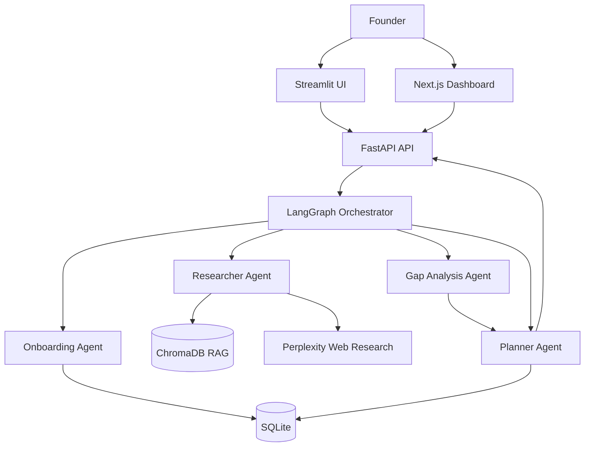

# Agentic Business Ops

Agentic Business Ops is an AI-powered business consultancy platform for Egyptian startups. It turns startup documents and goals into structured profiles, evidence-backed answers, gap analysis, and time-bound action plans.

## What it does

- **Onboards a startup** by extracting business context from uploaded PDF, Word, or text documents.
- **Answers business questions** using the startup's documents and online market research.
- **Analyzes gaps** between the startup's current position and relevant best practices.
- **Generates action plans** with phases, tasks, dates, priorities, dependencies, and strategy advice.
- **Stores profiles and plans** in SQLite and uses ChromaDB for document retrieval.

## Architecture



The orchestrator shares a typed state between agents and routes each request according to the task. Research combines local document retrieval with online benchmarks, while the planner uses the resulting context to produce a structured schedule.

## Main workflows

### Document onboarding

1. Upload a business document through `POST /api/upload`.
2. The onboarding agent extracts a structured startup profile.
3. The profile and source files are saved for later questions and planning.

### Question answering

1. Send a question through `POST /api/question`.
2. The orchestrator routes it to the researcher.
3. The researcher combines offline RAG context and online research.
4. The API returns an answer with supporting evidence.

### Plan generation

1. Send a startup goal and time horizon through `POST /api/plan`.
2. The orchestrator gathers research and identifies relevant gaps.
3. The planner returns phases and dated tasks.
4. The plan is saved in SQLite and returned in a UI-friendly format.

## Technology stack

| Area | Technology |
| --- | --- |
| API | FastAPI, Uvicorn, Pydantic |
| Agent orchestration | LangGraph, LangChain |
| LLM and web research | Perplexity AI |
| Retrieval | ChromaDB, Sentence Transformers |
| Storage | SQLite |
| Interfaces | Streamlit and Next.js/React |
| Observability | Optional LangSmith tracing |

## Repository structure

```text
.
├── backend/
│   ├── agents/
│   │   ├── onboarding/       # Document ingestion and profile extraction
│   │   ├── researcher/       # Offline RAG and online research
│   │   ├── Planner/          # Plan and schedule generation
│   │   ├── gap_analysis/     # Startup gap identification
│   │   └── orchestrator/     # LangGraph routing and shared workflow
│   ├── data/db/              # SQLite persistence
│   ├── tools/                # Tracing and shared utilities
│   ├── api.py                # FastAPI endpoints
│   └── tests/                # Agent, API, and integration tests
├── frontend/AI_Co-pilot/     # Next.js dashboard
├── source/                   # Sample source documents
├── streamlit_app.py          # Local Streamlit interface
├── streamlit_app_cloud.py    # Streamlit Cloud-integrated interface
├── render.yaml               # Render backend deployment
└── requirements.txt          # Root Python dependencies
```

## Getting started

### 1. Configure the environment

Create a `.env` file in the repository root:

```env
PERPLEXITY_API_KEY=your_perplexity_key

# Optional tracing
LANGSMITH_API_KEY=your_langsmith_key
LANGSMITH_PROJECT=agentic-business-ops
LANGSMITH_ENDPOINT=https://api.smith.langchain.com
```

### 2. Install Python dependencies

```bash
python -m venv .venv

# macOS/Linux
source .venv/bin/activate

# Windows PowerShell
# .venv\Scripts\Activate.ps1

pip install -r requirements.txt
```

### 3. Start the backend

From the repository root:

```bash
uvicorn backend.api:app --reload --port 8000
```

The interactive API documentation is available at [http://localhost:8000/docs](http://localhost:8000/docs).

### 4. Start the Streamlit interface

In a second terminal:

```bash
streamlit run streamlit_app.py
```

The local interface connects to `http://localhost:8000` by default.

### 5. Start the Next.js dashboard

```bash
cd frontend/AI_Co-pilot
pnpm install
pnpm dev
```

## API endpoints

| Method | Endpoint | Purpose |
| --- | --- | --- |
| `GET` | `/api/health` | Check API availability |
| `POST` | `/api/upload` | Upload and process a startup document |
| `POST` | `/api/question` | Ask a question about a startup |
| `POST` | `/api/plan` | Generate a business action plan |
| `GET` | `/api/profile/{startup_id}` | Retrieve a startup profile |
| `GET` | `/api/plans/{startup_id}` | List plans for a startup |
| `GET` | `/api/plan/{plan_id}` | Retrieve one plan |

## Testing

Run the backend test suite from the repository root:

```bash
pytest backend/tests -v
```

For environment and service diagnostics:

```bash
python backend/verify.py
```

Tests cover agent contracts, onboarding, research, planning, orchestration, API health, database operations, and end-to-end flows.

## Deployment

- **Backend:** Render using [`render.yaml`](render.yaml).
- **Streamlit interface:** Deploy `streamlit_app_cloud.py` to Streamlit Community Cloud and configure the required secrets.
- **Next.js dashboard:** Build and run the app from `frontend/AI_Co-pilot`.

The Perplexity API key is required for live onboarding, research, and plan generation. LangSmith is optional and is used only for tracing and debugging.
